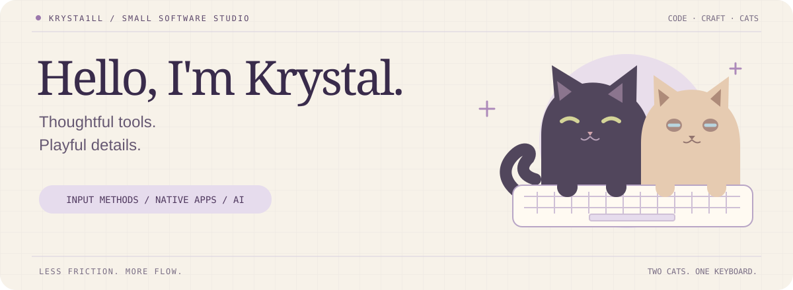

  

  <a href="#about">关于我</a> &nbsp;·&nbsp;
  <a href="#work">作品</a> &nbsp;·&nbsp;
  <a href="#toolbox">工具箱</a> &nbsp;·&nbsp;
  <a href="https://github.com/Krysta1ll?tab=repositories">所有仓库 ↗</a>

 

### 01 / 一点自我介绍

我是 **Krystal**，喜欢把日常使用中的小摩擦，写成顺手的小工具。

这里主要放输入法、原生应用，以及 AI 与自动化方面的探索。比起堆叠功能，我更在意输入是否流畅、界面是否清楚，以及那些每天会碰到的小细节。

最近的重心是 **喵扑 Meowpuut**：让中文、日文与英文在同一个输入过程中自然衔接。两只猫负责陪伴，代码负责把事情做好。

*I build input methods, native apps and small experiments in AI, with care for the details people use every day.*

 

### 02 / 正在打磨的作品

<table>
<tr>
<td width="50%" valign="top">

#### 喵扑 · Meowpuut
**从一次顺手的输入开始。**

注音、拼音、中日混打与英文混输。把输入引擎和两只猫，装进每天都在用的键盘里。

iPhone / iPad · macOS · Android · Windows

[看看喵扑 ↗](https://github.com/Krysta1ll/Meowpuut)

</td>
<td width="50%" valign="top">

#### Meowpuut Core
**界面之下，字句之间。**

喵扑共用的 Rust 引擎、C 接口与词库。处理句子分段、候选排序，以及跨语言输入。

Rust · C FFI · Lexicon

[走进核心 ↗](https://github.com/Krysta1ll/Meowpuut-Core)

</td>
</tr>
</table>

 

### 03 / 工具箱与关注点

| 方向 | 我在意的事 |
| :--- | :--- |
| **输入与语言** | 注音、拼音、混合输入、词库和候选排序 |
| **原生应用** | 系统集成、响应速度、清楚而克制的界面 |
| **AI 与自动化** | 把重复步骤交给工具，把注意力留给真正要做的事 |

**常用工具** &nbsp; Swift · Rust · Python · TypeScript · Git

 

---

  把复杂留给代码，把轻松留给使用的人。 
  Small tools, made with care. &nbsp; / &nbsp; Krysta1ll

